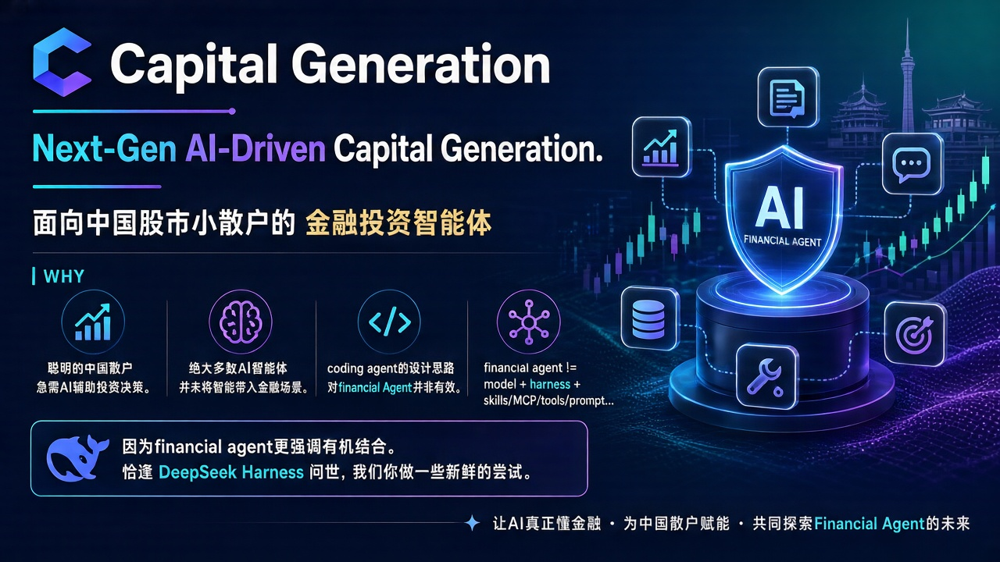
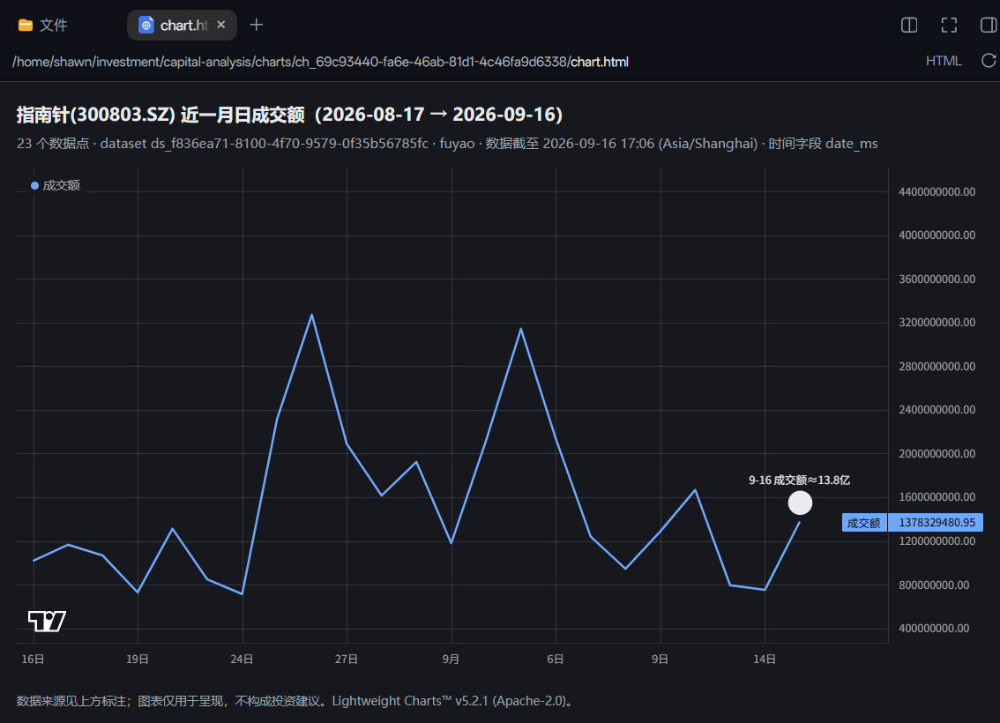
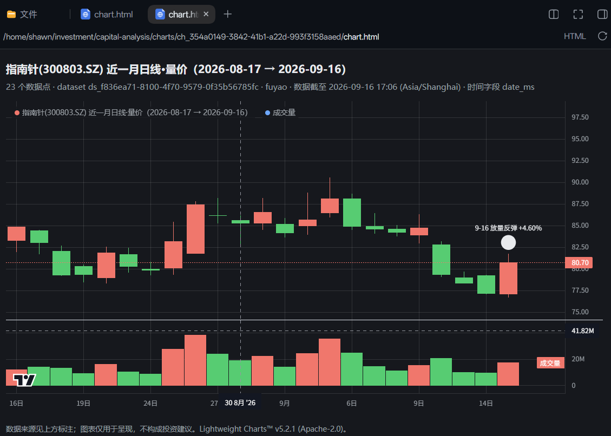
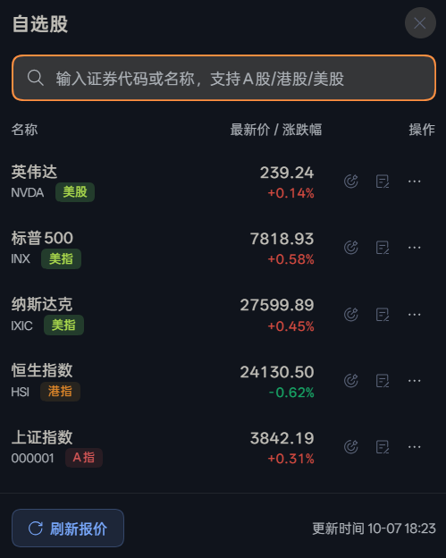
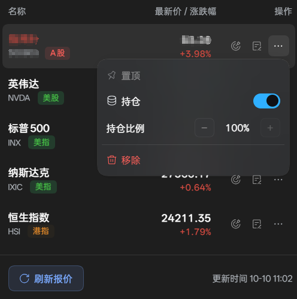
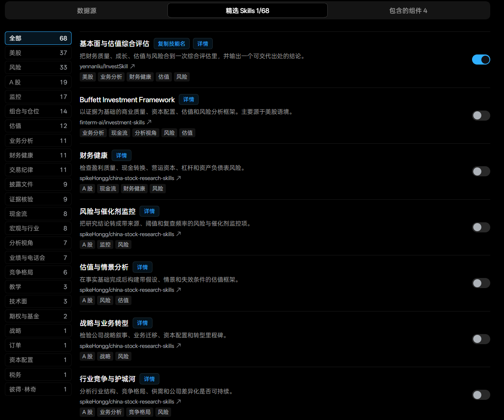
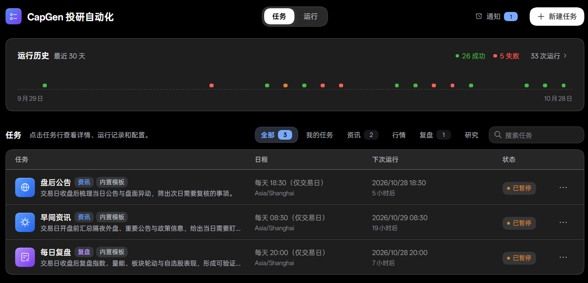
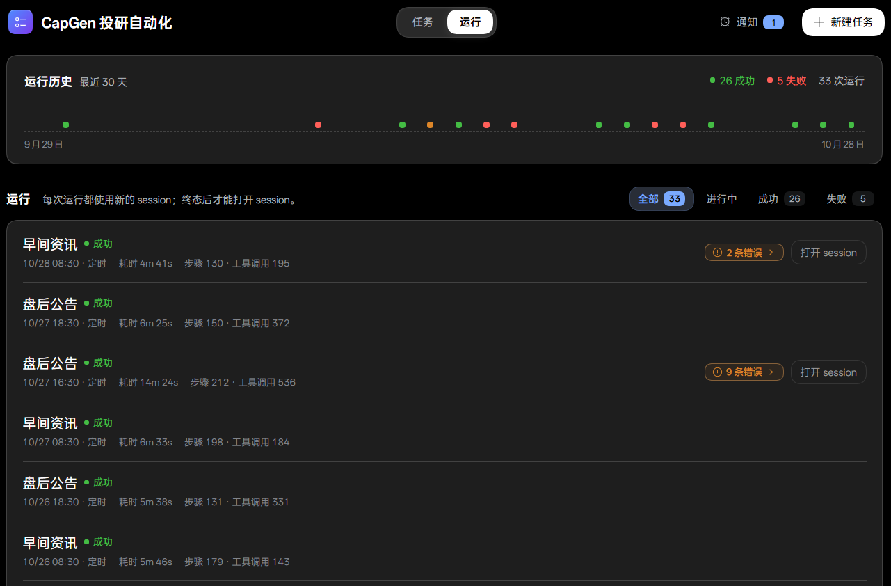

<p align="center">
  
</p>

<p align="center">
  <a href="https://github.com/v587d/capital-generation"></a>
  <a href="https://github.com/v587d/capital-generation"></a>
  <a href="https://github.com/v587d/capital-generation">
    
  </a>
</p>
<p align="center">
  <a href="https://github.com/deepseek-ai"></a>
  <a href="https://github.com/deepseek-ai"></a>
  <a href="https://github.com/deepseek-ai"></a>
  <a href="https://github.com/deepseek-ai"></a>
</p>
<p align="center">
  <a href="https://awesome-dsh-plugin.com"></a>
  <a href="LICENSE"></a>
  <a href="https://github.com/v587d/capital-generation/releases"></a>
  <a href="https://www.npmjs.com/package/@v587d/capital-generation"></a>
  <a href="https://github.com/deepseek-ai/deepseek-harness"></a>
</p>

# Capital Generation

> Next-Gen AI-Driven Capital Generation.

Capital Generation 是运行在 [DeepSeek Harness（DSH）](https://github.com/deepseek-ai/deepseek-harness) 里的证券研究插件，面向关注 A 股、港股、美股的个体投资者。安装后，新会话的选择器里会多出 **自动模式**、**行情专家**、**资讯专员** 三个模式；日常研究选 **自动模式**，用自然语言查行情、财务数据、公告和新闻，由它安排取数、数据质检、资料检索与图表，最后给出带来源的结论。它不是独立应用，需要先安装 DSH。

**🎞️视频演示：**[安装、配置与使用](https://www.bilibili.com/video/BV1fzaZ6CE9J/)。

> [!IMPORTANT]
> 本项目仍在探索中，不提供代交易服务，不保证数据完整、及时或准确，也不承诺投资回报。请自行核对来源并承担投资风险。

## 「🎉 CapGen 投研自动化」 已上线，欢迎试用并提 issue 💕 [快速了解](#capgen-automation)

## 快速上手

> [!NOTE]
> 最新版本已适配 DSH`@0.2.1-rc.3`。


0. **前置**

    **建议用独立 profile 启动。** 比如：
       
    ```bash
      dsh --profile capital --port 8888
    ```
    然后访问 `http://localhost:8888`。这样，本插件只属于 capital 这个 profile，避免和其他 profile 冲突。

1. **安装插件**

    Linux / macOS ：

    ```bash
    dsh plugin --profile capital add @v587d/capital-generation
    ```
    或
    ```bash
    dsh plugin --profile capital add github:v587d/capital-generation
    ```

    DSH 桌面端在 「添加插件」 中输入：

    ```input
    https://github.com/v587d/capital-generation
    ```
    或
    ```input
    @v587d/capital-generation
    ```
    **本仓库已包含构建产物，普通用户不需要克隆仓库或运行构建命令。**

2. **选填密钥** （打开 DSH 「插件」 → **Capital Generation** →「数据源」）
  
    本插件所有自带密钥均可免费申请、免费日常使用。哪怕所有密钥留空也不影响插件核心功能，即缺哪个密钥，仅表示对应能力就不可用，其他功能照常。
  
     | 密钥 | 用途 |
     | --- | --- |
     | [同花顺 Fuyao](https://fuyao.aicubes.cn/docs/) | 行情、财务数据和自选股报价 |
     | [AnySearch](https://www.anysearch.com/docs) | 网页搜索和正文提取 |
     | [Wind Alice](https://market.windalice.com/#/home) | 公告与新闻检索，以及宏观/行业/汇率指标与按日期区间取的历史 K 线 |
     | [PaddleOCR AIStudio](https://aistudio.baidu.com/paddleocr) | 解析 PDF 和图片中的文字 |
     | [FTShare（非凸科技）](https://market.ft.tech/gateway/doc/p/pb8eizu3) | A 股行情与日 K 截面、主力资金流、涨跌停、龙虎榜席位、股东人数、指数权重、可转债行情、宏观利率，以及期货合约与贵金属行情等第二家上游口径 |

    第三方服务的密钥，需分别向服务方申请；额度和条款以各服务方为准。保存后 **新建会话** 即可生效，无需重启。

    也可以直接把密钥写入`~/.dsh/.credentials.yaml`，名称依次为 `FUYAO_API_KEY`、`ANYSEARCH_API_KEY`、`WIND_API_KEY`、`PADDLE_OCR_TOKEN`、`FTSHARE_API_KEY`。

    密钥由 DSH 凭据服务保存。

3. **新建会话。** 新会话的模式选择器里会看到三个自定义模式。日常研究选 **自动模式**，然后直接描述研究问题；也可以到「设置」→「Agent 预设」把它设为默认模式。

    | 模式 | 适合什么 | 会做什么 | 边界 |
    | --- | --- | --- | --- |
    | **自动模式**（推荐） | 投研报告、事件影响、持仓复盘，以及需要同时查数、查资料和出图的综合问题 | 统一调度取数、数据质检、资料检索与绘图，汇总证据后直接答复 | 自动模式不直接取数，也不直接画图；每个数字都要有来源与截止时间 |
    | **行情专家** | 只想拿一份结构化行情、财务或宏观数据 | 查询并保存到当前会话，返回数据引用、来源与截止时间 | 只负责取数，不读取数据内容、不做判断；数据只在当前会话可用 |
    | **资讯专员** | 只要公告、新闻或互动平台材料 | 检索公告与新闻，逐条标注来源与核验状态 | 不做投资分析，也不给买卖建议 |

    **分析师**与**绘图专员**是自动模式的内部角色，不出现在选择器里。自动模式会在需要时创建并调度它们；它们没有独立的取数入口，单独打开也读不到本次研究的数据。

    **每份结构化数据都会先做质检。** 无论你有没有提图表，自动模式收到行情或财务数据后都会先交给分析师检查结构、时间轴、缺失与基础统计；要不要图是检查之后的一个判断。明确说“不要图”时，质检照做，只是停在出图之前。

    自动模式会把子角色工作期间的中间回执留在同一轮里处理，等材料收齐后再给出完整结论，而不是每条中间进展都单独回一段。

## 试试这么用

在新的自动模式会话中使用以下指令。将方括号内容换成自己的标的、公告或持仓；证券代码写完整市场后缀，例如 `600519.SH`。每条指令单独发送，便于观察结果。

[样例：指南针、同花顺复盘分析报告（20261023）](docs/sample/指南针-同花顺-复盘分析报告.md)

<details>
<summary>展开示例指令</summary>

**完整投资研究报告**

```instruction
请对[公司名称、俗称]([证券代码])做一份完整投资研究报告。
以你实际取得的最新可用数据为截止，覆盖业务、财务、估值、价格走势、近期重要事件以及风险与反方观点。
先给核心判断和最大风险；关键数字注明报告期或交易日、来源和采集时间。
证据不足的部分注明未评估及原因，不编造目标价或收益概率。
```

**事件与公告影响分析**

```instruction
请核查[公司名称]([完整证券代码])的[公告标题及披露日期，或“最近一次业绩公告”]，
分析它对经营、现金流和投资风险可能产生的影响。
先核对公告原文、披露时间和事项进展，区分已实施事实与尚待批准的方案；
如讨论股价反应，只比较公告后可交易时段和同窗市场走势，不把同期涨跌直接归因于公告。
给出最大不确定性和后续验证指标，找不到原文时不要假设事件已发生。
```

**持仓与组合复盘**

```instruction
请复盘我的持仓[其他资产如有，请补充]。
请先核对这些比例是否覆盖全部资产，再分析单只标的、行业与市场的集中风险，
以及哪些风险会同时影响多个持仓。
我没有提供交易流水或成本，不要计算期间收益、最大回撤或收益归因；
我只在自选股里标过持仓的那几只才算仓位，没标的只是关注。
给出最需要核实的信息和可观察的防守选项。
```

</details>

## 还能做什么

- **查数据和资料：** 覆盖 A 股、港股、美股与期货等品种，由专用角色按需获取行情、财务、指数、基金、宏观行业与期货数据，检索公告、新闻和研报。共计 **128** 个数据收集能力和 **14** 个网页检索能力，部分公开数据源无需额外密钥；具体覆盖范围见 [数据收集能力表](docs/data-collector-capabilities.md) 和 [网页检索能力表](docs/web-retriever-capabilities.md)。
- **数据质检：** 结构化数据不会直接进入模型上下文。每份数据先由分析师检查结构、时间轴、缺失与基础统计，再按受控方式汇总；原始数据行始终留在工具层。
- **可视化：** 分析师判断数据适合图表，或你明确要图时，绘图专员会生成可交互图表；明确不要图时只完成质检。图表会登记为**最后一轮答复**的交付物，在答复末尾集中出现，可在侧栏查看或离线打开。了解处理流程可看 [Agent 角色说明](docs/agent-roles.md)。

| 走势折线 | K 线与量价 |
| :---: | :---: |
| <a href="assets/chart-line-sidebar.png"></a> | <a href="assets/chart-candlestick-sidebar.png"></a> |

- **管理自选股：** 在 **自动模式、市场专家、资讯专家** 三种模式的会话中输入 `/` 或点击输入框旁的 `+`，从「指令」中打开「自选股」。

| 管理自选股 | 标记持仓 |
| :---: | :---: |
| <a href="assets/watchlist-popup.png"></a> | <a href="assets/watchlist-more.png"></a> |

- **精选 Skills：** 当前收录 8 个开源项目、共 70 个 Skill。默认不开启「智能装载 Skills」，逐项清单和勾选都在；打开后清单收起，按角色开放该角色全部方法，由模型按任务挑 1–2 条，运行期不再看勾选。两种状态都按角色分发：研究/组合方法归自动模式，估值/财务/风险/筛选归分析师，文档深读与核验归资讯专员；无需新建会话，下一轮就生效。

<p align="center">
  <a href="assets/selected-skills配置.png">
    
  </a>
</p>

| 项目名称 | 收录边界 |
| :---: | :---: |
| [The Investment Skills Lexicon](https://github.com/finterm-ai/investment-skills) | Buffett Investment Framework |
| [China Stock Research Skills](https://github.com/spikeHongg/china-stock-research-skills) | 6 个 A 股研究 Skill |
| [InvestSkill](https://github.com/yennanliu/InvestSkill) | 28 个美股 Skill：逐条主张核验、空头反方、披露文件与内部人追踪、压力测试等 |
| [Peter Lynch Research](https://github.com/DjNero11/peter-lynch-skill) | 一条完整的个股研究流程 |
| [Trading Skills](https://github.com/marian2js/trading-skills) | 11 个交易过程 Skill：催化剂排布、自选股分诊、论点压力测试、执行计划检查、入场仓位测算、持仓论点复核、交易日志复盘等，美股与境外交易口径 |
| [Claude for Financial Services CN](https://github.com/jwangkun/claude-for-financial-services-cn) | 12 个 A 股卖方研究 Skill：业绩点评与差异表述、财报前瞻、可比倍数、A 股 DCF 口径、行业全景、催化剂日历、财务核查、晨会纪要、持仓逻辑跟踪与选股清单等 |
| [FinanceSkills](https://github.com/GAJETOso/financeskills) | 8 个估值与财务方法 Skill：折现率（WACC）估算、三表勾稽建模、企业估值与股权价值桥、偿债能力与债务容量、预期信用损失三阶段、银行资本与流动性、保险准备金与综合成本率、账务异常排查；按 IFRS / 美股与国际准则口径写，境内监管阈值与科目名需自行对照 |
| [Quant Agent Skills](https://github.com/Howard-Jerry/quant-agent-skills) | 1 个跨市场选线 Skill：同一家公司在 A 股与港股、或美股 ADR 与港股各有一条线时该走哪一条——价差、币种与股息税、流动性与通道、披露文件路径各不相同。公司本身只研究一次，便宜的那条线不构成"这家公司更值得买"；A/H 溢价与 ADR 平价没有现成条目，须按两条线同一天的收盘价与当日汇率现算，缺任一项就只报缺的那一项 |

<a id="capgen-automation" name="capgen-automation"></a>
- **CapGen 投研自动化：** 内置早间资讯、盘后公告与每日复盘三个模板，也可新建自己的任务；到点自动新建 session 执行，也能手动运行。任务、运行历史与失败通知在同一页，支持运行预算、通知和仅交易日触发。

<p align="center">
  <a href="assets/capgen-automation-tasks.png">
    
  </a>
</p>
<p align="center">
  <a href="assets/capgen-automation-runs.png">
    
  </a>
</p>

## 常见问题

- **安装后找不到模式？** 确认插件出现在「插件」→ 已安装列表；Web / CLI profile 安装后要重启该 profile，并在新会话选择模式。选择器里应看到自动模式、行情专家、资讯专员；分析师和绘图专员是自动模式的内部角色，不会出现在这里。
- **配置在哪？** 打开「插件」→ 已安装的 **Capital Generation**，页面顶部就是「数据源 / 精选 Skills / 包含的组件」三格，五把密钥都在第一格；不在 DSH 的普通「设置」页面，也不用点进任何一行组件。保存密钥后新建会话再试。
- **升级到 2.9.0 后，分析师和绘图专员去哪了？** 这一版把它们收进自动模式内部，不再出现在选择器与预设管理里，避免误开一个没有取数入口的空会话。旧会话仍能按原身份恢复；新任务直接用自动模式提出即可。
- **桌面端升级后仍是旧版？** 桌面端安装时会固定所解析的版本，不会自动升级。卸载后重新安装，再到插件详情查看版本号；如需指定版本，可在地址末尾加 `#v2.14.1` 或 `@2.14.1`。
- **刚发布的新版本装不到？** 桌面端取包时会跳过**刚发布不久**的版本（宿主侧包管理器的发布冷却策略，实测会静默装成上一个版本），国内镜像的同步也可能滞后一段时间。急着用最新代码，改用仓库地址安装最直接。
- **网页抓取失败？** 配置卡片中的「允许启动本地提取网页内容」默认开启：AnySearch 提取失败时可尝试本机直连。关闭后，本机直连的具名来源查询也不可用；请检查该开关和网络连接。
- **Wind 那部分会消耗积分？** 会。公告与新闻检索、宏观 / 行业 / 汇率指标、按日期区间取的历史 K 线都按次消耗你在 Wind 侧的额度；额度与条款以 Wind 为准，插件不做用量封顶。没配 `WIND_API_KEY` 时这几类不可用，其余功能照常。
- **没有加载想要的精选 Skill？** 先看「智能装载 Skills」开关：关着时只给已勾选的方法；打开后按角色放开全部方法，但仍由模型判断任务是否命中。再确认它归哪个预设——自动模式偏研究/组合/写作，估值、财务与筛选由分析师在计算时加载，文档深读与核验由资讯专员加载。列表上方可以按「Skill 特点」和「适用预设」两个维度取交集筛选；点技能名可看原文。需要强制使用时，在对话里直接输入 `/` 加原文中的英文名（例如 `/china-earnings-analysis`），不要用中文标题。
- **怎么知道这次分析用了哪些精选 Skill？** 最终答复会有一节「使用的方法」，逐项列出实际加载过的 Skill 并说明各自支撑了哪个判断；主 Agent 和子 Agent 的加载都会计入。没有加载过就不会出现这一节，答复里也不会挂没读过的名字。
- **精选 Skill 的方法论很长，Agent 读得完吗？** 读得完。超过一次可读长度的正文已经重排成「入口 + 分册」：Agent 先看入口目录，需要具体规则、模板或阈值时把对应那一册整本读进来，并会告诉你它读了哪几册、哪些没读。设置卡片里点技能名打开的原文预览仍然只给入口那一份，想看某一册直接问 Agent。

目前 Windows 桌面端有一项[已知宿主差异](CHANGELOG.md)：自动模式的出图与检索限制可能不生效。请留意它实际调用了哪些工具；结构化数据的取数边界仍由工具层执行。

## 开发与贡献 
普通用户不需要执行下面的命令。修改源码时请参考 [贡献指南](CONTRIBUTING.md) 和 [开发约定](AGENTS.md)：

[](https://octocounts.com/github/v587d/capital-generation/tree/master)

```bash
npm install
npm run build       # 构建 lib/ 和浏览器端资源
npm test            # 构建并运行测试
npm run check:dsh   # 检查 DSH 扩展面兼容性
npm run smoke:boot  # 检查插件装配
```

完整版本历史见 [CHANGELOG.md](CHANGELOG.md)。问题与建议可到 [Issues](https://github.com/v587d/capital-generation/issues) 或 [DSH官方 Discussions](https://github.com/deepseek-ai/deepseek-harness/discussions/6947) 交流。本项目采用 [MIT 许可](LICENSE)。

## 致谢

- 「精选 Skills」的研究、交易过程与财务方法 Skill 按固定 commit **快照收录**自 [finterm-ai/investment-skills](https://github.com/finterm-ai/investment-skills)、[spikeHongg/china-stock-research-skills](https://github.com/spikeHongg/china-stock-research-skills)、[yennanliu/InvestSkill](https://github.com/yennanliu/InvestSkill)、[DjNero11/peter-lynch-skill](https://github.com/DjNero11/peter-lynch-skill)、[marian2js/trading-skills](https://github.com/marian2js/trading-skills)、[GAJETOso/financeskills](https://github.com/GAJETOso/financeskills)、[Howard-Jerry/quant-agent-skills](https://github.com/Howard-Jerry/quant-agent-skills)（以上均 MIT License）与 [jwangkun/claude-for-financial-services-cn](https://github.com/jwangkun/claude-for-financial-services-cn)（Apache-2.0）。快照目录、收录口径与逐颗排除理由见 [selected-skills/](selected-skills/README.md)，第三方组件与许可见下面的清单文件。
- 会话里的可交互图表由 [TradingView Lightweight Charts](https://github.com/tradingview/lightweight-charts)（Apache-2.0）渲染，图上保留它自带的归属标识。
- 行情、财务、公告与网页材料来自五类需自备密钥的服务（同花顺 Fuyao、Wind Alice、AnySearch、PaddleOCR、FTShare 非凸科技）与一批公开口径的来源（东方财富、腾讯、新浪、财联社、华尔街见闻、巨潮互动易、上证 e互动、同花顺公开站点）；数据版权归各服务方，额度与条款以服务方为准，本项目不重新分发原始数据。

第三方组件、版本与许可，以及宿主提供哪部分、构建期用什么、各服务的数据会出到哪些地方，逐条列在 [第三方组件与许可](THIRD_PARTY_NOTICES.md)。
