# Overview

Part 1 of 3 for `industry-map` — Overview; 1. The Value Chain Model; 2. Step 1 — Define the Scope; 3. Step 2 — Build the Chain Map (the graph)
See `SKILL.md` for what to read and when; this part is procedure, not routing.

## Overview

Most analysis looks at one company in isolation. This skill zooms out and answers a different question: **"How does this whole industry actually work, layer by layer, and who captures the profit at each stage?"**

A value chain is a **directed graph**: nodes are the layers of production (raw materials → components → integrators → platforms → distribution → end users), and edges point in the direction goods and services flow — from supplier to customer. Once the chain is drawn, three things become visible that a single-company view hides:

1. **Position** — is the target company upstream (inputs), midstream (integration/manufacturing), or downstream (distribution / end demand)? Position determines cyclicality, margin profile, and who has pricing power over whom.
2. **Chokepoints** — the layer(s) with the fewest credible suppliers capture disproportionate value. Following the chain reveals bottleneck monopolies (e.g. EUV lithography, leading-edge foundry) that are the real toll-collectors of a theme.
3. **Value migration** — the profit pool is not fixed. It shifts down (or up) the chain over time as scarcity moves. Mapping the chain lets you form a thesis about *where the money goes next* — the "picks-and-shovels" and second-order plays.

This complements — and does not duplicate — the existing skills. `competitor-analysis` studies one company's moat *horizontally* against its direct peers; `sector-analysis` ranks the 11 GICS sectors for rotation. This skill maps a theme or product *vertically*, cutting **across** sectors, to show the whole flow. Output feeds naturally into `competitor-analysis` (pick a node, study its moat), `stock-screener` (rank the tickers at one layer), and, when a chart is wanted, the host chart channel (the graph spec stays in the answer; this plugin renders through `render_chart` only in its drawing role).

---

## 1. The Value Chain Model

Every physical or digital product can be decomposed into ordered layers. Use this generic template and adapt the layer names to the specific industry:

```
UPSTREAM ───────────────► MIDSTREAM ───────────────► DOWNSTREAM
(scarce inputs,           (integration, manufacture,   (distribution, demand,
 tools, IP)                assembly, platforms)          the end customer)

Raw materials / inputs
   → Enabling tools & equipment
      → Components / sub-systems
         → Integrators / OEMs
            → Platforms / aggregators
               → Channel / distribution
                  → End users / demand
```

**Node attributes** — for each layer, capture:
- **Layer name** and what it does in one line
- **Representative public tickers** (2–5) and any dominant private players
- **Position tag**: `Upstream` / `Midstream` / `Downstream`
- **Concentration**: how many credible suppliers exist (monopoly / oligopoly / fragmented)
- **Value capture today**: does this layer earn high or thin margins right now?

**Edge attributes** — for each arrow (supplier → customer):
- Direction of flow (always supplier → the layer that buys from it)
- Dependency strength (sole-source / multi-source / commodity)
- Whether the buyer can integrate backward, or the supplier forward

---

## 2. Step 1 — Define the Scope

Clarify what is being mapped. The input is usually one of three things:

| Input type | Example | What to map |
|---|---|---|
| **A theme / product** | "AI compute", "electric vehicles", "GLP-1 drugs" | The full chain end-to-end |
| **A single ticker** | `NVDA` | The chain around it, then locate it |
| **A layer** | "memory", "foundry" | That layer + its immediate up/downstream neighbors |

Confirm the boundaries: where does the chain start (how far upstream — mined ore? refined wafer?) and where does it end (the paying end user)? State the scope explicitly at the top of the output so the graph is bounded and legible.

---

## 3. Step 2 — Build the Chain Map (the graph)

Produce the directed graph. **Default to a Mermaid `flowchart`** (renders in Claude, Cursor, Gemini, GitHub, and the site); fall back to ASCII when Mermaid is unavailable. Keep this Mermaid block as the primary output; when a richer render is wanted, leave the graph spec in the answer for the host chart channel — this plugin exports no HTML.

**Mermaid flowchart (primary output):**

```mermaid
flowchart LR
    MAT["Materials & Substrates<br/>(silicon, rare earths)"] --> EQ["Fab Equipment<br/>ASML · LRCX · AMAT"]
    EQ --> FAB["Foundry / Fab<br/>TSMC · INTC · Samsung"]
    FAB --> MEM["Memory<br/>MU · Hynix · Samsung"]
    FAB --> GPU["GPU / Accelerators<br/>NVDA · AMD"]
    MEM --> GPU
    GPU --> NET["Networking / Interconnect<br/>AVGO · ANET"]
    NET --> CSP["Cloud / CSP<br/>AMZN · MSFT · GOOGL"]
    CSP --> LAB["Model Labs<br/>OpenAI · Anthropic"]
    LAB --> APP["AI Software / Apps"]
    APP --> USER["End Users<br/>enterprise · consumer"]
```



**ASCII fallback:**

```
Materials ─► Fab Equipment ─► Foundry ─┬─► Memory ──┐
             (ASML,LRCX,AMAT) (TSMC,INTC)   │            ▼
                                       └─► GPU/Accel (NVDA,AMD) ─► Networking (AVGO,ANET)
                                                                        │
   End Users ◄─ AI Software ◄─ Model Labs ◄─ Cloud/CSP (AMZN,MSFT) ◄────┘
   (enterprise,             (OpenAI,        (GOOGL)
    consumer)                Anthropic)
```

**Chain map table** — accompany the graph with a table so the data is machine-readable and feeds the later steps:

```
Layer                 Position    Key Tickers          Concentration     Value Capture (now)
──────────────────────────────────────────────────────────────────────────────────────────
Materials/Substrates  Upstream    SHECY, SUMCF         Fragmented        Low
Fab Equipment         Upstream    ASML, LRCX, AMAT     Oligopoly/Monopoly High  ◄ chokepoint
Foundry               Midstream   TSMC, INTC           Oligopoly         High
Memory                Midstream   MU, Hynix, Samsung   Oligopoly         Cyclical
GPU / Accelerators    Midstream   NVDA, AMD            Near-monopoly     Very High ◄ chokepoint
Networking            Midstream   AVGO, ANET           Oligopoly         High
Cloud / CSP           Downstream  AMZN, MSFT, GOOGL    Oligopoly         Medium (capex heavy)
Model Labs            Downstream  OpenAI, Anthropic    Fragmenting       Negative→? 
AI Software / Apps    Downstream  many                 Fragmented        Emerging
End Users             Demand      —                    —                 —
```

---


